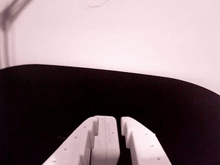

# MolmoAct-2 coarse-to-fine pick experiment

**The model approached the object but did not complete the grasp.**

The arm repeatedly moved up and down above the object without picking it up.
This led to the coarse-to-fine handoff: use MolmoAct-2 for the approach, then
switch to taught lower, clamp, and lift poses. The handoff uses a 15-second timer
and fixed poses, so the arm base and object placement must stay unchanged.



## Setup and run

Prerequisites:

- Apple Silicon Mac; the original setup had 48 GB memory.
- Assembled/configured [SO-101 follower](https://huggingface.co/docs/lerobot/so101) and two USB cameras.
- [Conda/Miniforge](https://docs.conda.io/projects/conda/en/stable/user-guide/install/index.html) and Git installed.
- Camera permission for terminal/Python on macOS; other robot/camera programs closed.

**Support the arm during teaching and disconnection: torque releases.**

From the repository root:

```bash
python3 baseline/run.py setup
conda activate lerobot
python baseline/run.py
```

| Command | What it does automatically |
|---|---|
| `setup` | Creates Conda env `lerobot` if missing; installs pinned Python dependencies, the LeRobot checkout and MPS patch. New environments include Python 3.12.12, pip and FFmpeg. |
| No command (the guide) | Runs setup if needed; asks for connection details, offers calibration, downloads/prepares weights, previews cameras, teaches poses, then asks before opening the model session. |
| `run --port ...` | Uses the Conda environment, runs preflight, loads the prepared model and connects. Run setup/prepare first; it does not reinstall dependencies or download weights. |

An existing environment must use Python 3.12 and have pip/FFmpeg available.
Setup exports its specifications before updating Python packages. To use a
separate environment, add `--env-name lerobot-baseline` to setup and later commands.
The launcher uses `conda run` if the selected environment is inactive.

### Run individual steps

After setup, with `lerobot` activated:

```bash
# Download and prepare model weights.
python baseline/run.py prepare

# Find the port; replace YOUR_PORT below. Skip calibration if already done.
ls /dev/tty.usbmodem*
python baseline/run.py calibrate --port /dev/tty.usbmodemYOUR_PORT

# Preview cam0=top, cam1=wrist; press Enter in the terminal to close.
python baseline/run.py cameras --top 0 --wrist 1

# Teach approach, lower, close, lift; then validate/print without moving.
python baseline/run.py teach --port /dev/tty.usbmodemYOUR_PORT
python baseline/run.py replay

# Load the model, connect, and open the interactive session.
python baseline/run.py run --port /dev/tty.usbmodemYOUR_PORT
```

Use the same `--id` for calibration, teaching and running; the default is
`my_awesome_follower_arm`. Waypoints are saved to `outputs/waypoints/grasp.json`.
Teaching never overwrites files; select a new path with `--grasp`.

During teaching, Enter captures a pose and `q` cancels. `replay --execute` moves
through every saved pose, so review the physical path first. Historical files in
`reference_waypoints/` belong to the old arm/scene.

## Interactive commands

The arm starts idle after loading and connecting.

| Command | Behavior |
|---|---|
| `/commit` or `/commit 20` | Run policy for 15 or 20 seconds, then lower/clamp/lift and hold. |
| `/commit reset` | Commit, then return to the session's initial pose. |
| `/commitandrecord` | Commit plus top/wrist MP4s through five seconds of hold; accepts seconds/reset. |
| `/start` | Run the policy alone for 30 seconds by default. |
| `/subtask <text>` | Change the model's instruction. |
| `/reset` | Interrupt motion and return to the pose captured at session startup. |
| `/stop` | End the session, disconnect, release torque. |
| `/help` | Show available commands. |

Wait for a run to finish or reset before another commit. Blocking inference or
hardware calls can delay reset/stop.

Default `sync` mode executes 30 actions per observation; `--mode replan` executes
8, and `--mode prefetch` queues chunks with RTC guidance disabled. Commit forces
the clamp/lift gripper target to `0`; override with `--closed-gripper`. Replay
uses taught targets unchanged. See `--help` for other options.

## Related reports and possible causes

The cause of our repeated up/down motion remains unresolved. These references suggest checks:

| Source | Relevance |
|---|---|
| [Independent MolmoAct-2 SO-101 evaluation](https://huggingface.co/datasets/abdul004/molmoact2-so101-zero-shot-eval) | Reports stalling or near-current-pose targets after initial movement, in a different setup. |
| [Official MolmoAct-2 deployment guide](https://huggingface.co/docs/lerobot/molmoact2#joint-frame-transform-so-100101-zero-shot) | Documents a calibration-frame mismatch. The converted checkpoint already corrects it; preserve its processors and check camera mapping. |
| [ACT paper, §V-A](https://roboticsproceedings.org/rss19/p016.pdf) | Abrupt action-chunk transitions can cause jerky motion. |
| [LeRobot RTC guide](https://huggingface.co/docs/lerobot/rtc) | Slow inference and disagreeing chunks can cause pauses and strategy changes. |

**Hypothesis to test:** `replan` executes only the first 8 of 30 predicted actions.
If closure occurs later, repeated replanning could discard it. Compare full
predictions with executed targets; this explanation is unconfirmed.

## Reproducibility

- **Pins:** [sources.json](sources.json) records model/LeRobot revisions and Python; [requirements-lock.txt](requirements-lock.txt) pins dependencies installed inside Conda. The exact original environment was not recorded.
- **Saved outputs:** `outputs/runs/<timestamp>/` holds code/config snapshots, environment exports, launch options, action traces and images. `/commitandrecord` adds videos. Environment backups go in `outputs/environment-backups/`.
- **Known limits:** model inference and physical grasping remain unvalidated after this refactor. The handoff has no alignment/contact feedback; CUDA/CPU adaptations are also unvalidated.

Back up models, run outputs and robot calibration files separately from Git.

## Files and checks

| File | Responsibility |
|---|---|
| [run.py](run.py) | Setup, model preparation, calibration, cameras and launch. |
| [session.py](session.py) | Interactive handoff, recording and action traces. |
| [waypoints.py](waypoints.py) | Pose capture, validation, replay and motion helpers. |

The original GIF, taught poses and [MPS patch](patches/lerobot-mps-loader.patch)
are retained here. Earlier scripts remain in Git at `9cb398d`.

Hardware-free checks (the controller integration test requires setup first):

```bash
python3 baseline/run.py setup --dry-run
python3 baseline/run.py run --port /dev/example --dry-run
python3 -m unittest discover -s baseline/tests -v
```
